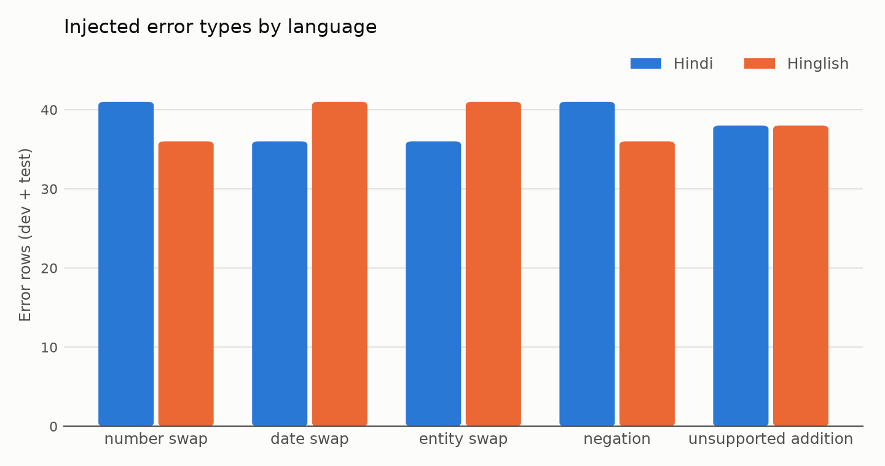

# FactIndic – Paper Outline

Working title: *FactIndic: Claim-Level Verification and Selective Repair of Factual Errors in
Hindi and Hinglish Summaries*

## Abstract
[TODO – write last: problem, method (claim decomposition → evidence retrieval → NLI + rule
checks → selective repair), dataset, headline numbers, takeaway.]

## 1. Introduction
[TODO – hallucination in LLM summaries; low-resource / code-mixed gap for Hindi and Hinglish;
research question; contributions list.]

## 2. Related Work
[TODO – factual consistency metrics (QAGS, SummaC, FactCC, AlignScore); claim-level
verification (FActScore); post-hoc correction; multilingual NLI; Indic and code-mixed NLP.]

## 3. Dataset

We construct FactIndic-Synth, a controlled benchmark of 128 news-style articles (64 Hindi in
Devanagari script and 64 Hindi–English code-mixed in Latin script) spanning eight domains
(politics, sports, business, health, education, environment, technology, infrastructure), each
paired with a reference summary and 5–6 gold atomic claims. Articles are generated from
domain-specific templates whose slots (persons, organisations, locations, quantities, dates and a
polarity phrase) are sampled with a fixed seed, which yields exact character-level gold
annotations for every key fact. Each source additionally contains a distractor quantity that does
not appear in the summary.

For each article we derive one faithful summary and three corrupted summaries, each containing
exactly one injected error of a distinct type (number swap, date swap, entity swap, negation flip
or unsupported addition), resulting in 512 summary instances balanced across error types (76–77
instances per type). To approximate real-world input noise, a subset of source documents contains
Devanagari numerals (29 of 64 Hindi articles) or informal spelling variation (66 of 128
articles), while summaries remain in standard orthography. The data is split by article into a
development set (40 articles, 160 summaries) used exclusively for threshold tuning and a held-out
test set (88 articles, 352 summaries) used for all reported results, which prevents leakage
between faithful and corrupted versions of the same article.

#### Table 1. Articles per language x domain x split

| language | domain | dev | test | total |
|---|---|---|---|---|
| hindi | business | 3 | 5 | 8 |
| hindi | education | 2 | 6 | 8 |
| hindi | environment | 3 | 5 | 8 |
| hindi | health | 2 | 6 | 8 |
| hindi | infrastructure | 2 | 6 | 8 |
| hindi | politics | 3 | 5 | 8 |
| hindi | sports | 3 | 5 | 8 |
| hindi | technology | 2 | 6 | 8 |
| hinglish | business | 2 | 6 | 8 |
| hinglish | education | 3 | 5 | 8 |
| hinglish | environment | 2 | 6 | 8 |
| hinglish | health | 2 | 6 | 8 |
| hinglish | infrastructure | 3 | 5 | 8 |
| hinglish | politics | 3 | 5 | 8 |
| hinglish | sports | 3 | 5 | 8 |
| hinglish | technology | 2 | 6 | 8 |
| total |  | 40 | 88 | 128 |

#### Table 2. Summary rows per error type x language x split

| error_type | hindi_dev | hindi_test | hinglish_dev | hinglish_test | total |
|---|---|---|---|---|---|
| none | 20 | 44 | 20 | 44 | 128 |
| number_swap | 9 | 32 | 9 | 27 | 77 |
| date_swap | 10 | 26 | 12 | 29 | 77 |
| entity_swap | 14 | 22 | 14 | 27 | 77 |
| negation | 14 | 27 | 14 | 22 | 77 |
| unsupported_addition | 13 | 25 | 11 | 27 | 76 |
| total | 80 | 176 | 80 | 176 | 512 |

#### Table 3. Mean article and summary length

| language | article_words | article_chars | summary_words | summary_chars | compression_ratio_words |
|---|---|---|---|---|---|
| hindi | 77.1 | 396.5 | 35.4 | 186.0 | 2.2 |
| hinglish | 77.4 | 443.0 | 35.2 | 204.8 | 2.2 |
| all | 77.2 | 419.7 | 35.3 | 195.4 | 2.2 |

#### Table 4. Gold atomic claims per reference summary

| language | mean_claims | min_claims | max_claims | total_claims |
|---|---|---|---|---|
| hindi | 5.2 | 5 | 6 | 336 |
| hinglish | 5.2 | 5 | 6 | 336 |
| all | 5.2 | 5 | 6 | 672 |

#### Table 5. Source-side robustness conditions (article counts)

| language | articles | devanagari_digits | spelling_noise |
|---|---|---|---|
| hindi | 64 | 29 | 31 |
| hinglish | 64 | 0 | 35 |
| all | 128 | 29 | 66 |

#### Table 6. Key-fact type distribution

| type | hindi | hinglish | total | share_% |
|---|---|---|---|---|
| date | 64 | 64 | 128 | 20.0 |
| entity | 192 | 192 | 384 | 60.0 |
| number | 64 | 64 | 128 | 20.0 |
| total | 320 | 320 | 640 | 100.0 |

#### Figure 1. Injected error types by language

## 4. Methodology
[TODO – overview figure of the pipeline.]

### 4.1 Summary generation
[TODO – not used in the main experiments: candidate summaries are given by the benchmark.]

### 4.2 Claim decomposition
We decompose each summary into claims with a rule-based splitter that first segments sentences
using script-aware terminators (।, ., ?, !) with an abbreviation list covering both Latin (*Dr.*)
and Devanagari (*डॉ.*) forms, and then splits sentences at clause boundaries defined as a comma
followed by a Hindi or romanised-Hindi connective (e.g., *जिसके/jiske*, *जहाँ/jahan*,
*यह/yeh*). Each claim retains its character offsets in the summary, which allows errors to be
localised to a single claim and enables span-restricted repair. We compare this clause-level
splitter with a sentence-level baseline and with the gold atomic claims as an oracle upper bound;
an LLM-based decomposer is implemented but not evaluated, since all experiments run without
access to a commercial API.

| Method (test) | claims/summary | facts/claim | fact coverage % | context-dependent % | error localised % | collateral facts | text touched % |
|---|---|---|---|---|---|---|---|
| sentence | 3.00 | 1.67 | 100 | 3.8 | 100 | 1.19 | 35.5 |
| clause | 3.65 | 1.37 | 100 | 20.9 | 100 | 0.83 | 29.3 |
| gold (oracle) | 5.26 | 1.07 | 100 | 0.0 | – | – | – |

### 4.3 Evidence retrieval
[TODO – LaBSE, top-k.]

### 4.4 Verification
[TODO – multilingual NLI + rule checks (numbers, dates, negation, entities) and the decision rule.]

### 4.5 Selective repair
[TODO]

### 4.6 Re-verification and human-review routing
[TODO]

## 5. Experimental Setup
[TODO – models and versions (config.yaml), hardware (CPU), dev-only tuning protocol, baselines
and ablations, metrics (precision/recall/F1 per error type, balanced accuracy, content
preservation).]

## 6. Results
[TODO – detection results on test; per-error-type and per-language breakdown; repair results.]

## 7. Error Analysis
[TODO – qualitative failure cases: Devanagari digits, spelling noise, negation, additions.]

## 8. Limitations
[TODO – synthetic template-based data; single injected error; lexical negation only; romanised
Hinglish only; dependence on a commercial LLM API.]

## 9. Conclusion
[TODO]
