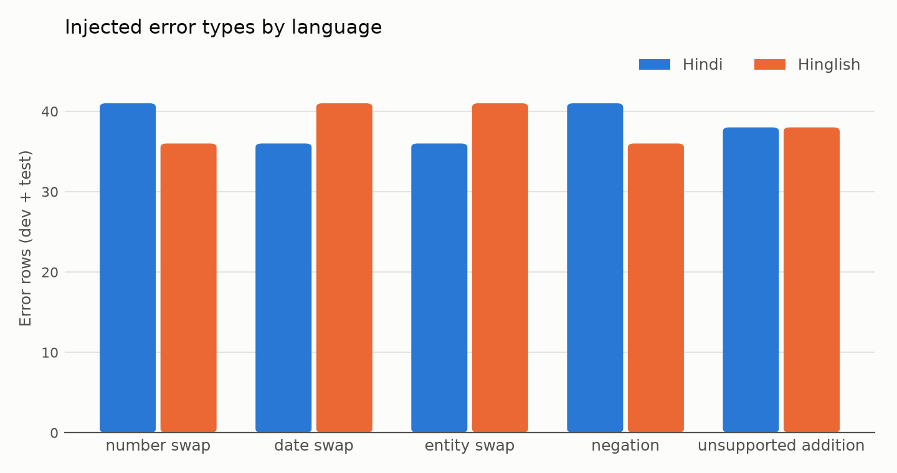

# FactIndic dataset statistics

Generated 20261124_011250 from `data/factindic_synth_articles.jsonl` (128 articles) and `data/factindic_synth_errors.jsonl` (512 rows).

## Table 1. Articles per language x domain x split

| language | domain | dev | test | total |
|---|---|---|---|---|
| hindi | business | 3 | 5 | 8 |
| hindi | education | 2 | 6 | 8 |
| hindi | environment | 3 | 5 | 8 |
| hindi | health | 2 | 6 | 8 |
| hindi | infrastructure | 2 | 6 | 8 |
| hindi | politics | 3 | 5 | 8 |
| hindi | sports | 3 | 5 | 8 |
| hindi | technology | 2 | 6 | 8 |
| hinglish | business | 2 | 6 | 8 |
| hinglish | education | 3 | 5 | 8 |
| hinglish | environment | 2 | 6 | 8 |
| hinglish | health | 2 | 6 | 8 |
| hinglish | infrastructure | 3 | 5 | 8 |
| hinglish | politics | 3 | 5 | 8 |
| hinglish | sports | 3 | 5 | 8 |
| hinglish | technology | 2 | 6 | 8 |
| total |  | 40 | 88 | 128 |

## Table 2. Summary rows per error type x language x split

| error_type | hindi_dev | hindi_test | hinglish_dev | hinglish_test | total |
|---|---|---|---|---|---|
| none | 20 | 44 | 20 | 44 | 128 |
| number_swap | 9 | 32 | 9 | 27 | 77 |
| date_swap | 10 | 26 | 12 | 29 | 77 |
| entity_swap | 14 | 22 | 14 | 27 | 77 |
| negation | 14 | 27 | 14 | 22 | 77 |
| unsupported_addition | 13 | 25 | 11 | 27 | 76 |
| total | 80 | 176 | 80 | 176 | 512 |

## Table 3. Mean article and summary length

| language | article_words | article_chars | summary_words | summary_chars | compression_ratio_words |
|---|---|---|---|---|---|
| hindi | 77.1 | 396.5 | 35.4 | 186.0 | 2.2 |
| hinglish | 77.4 | 443.0 | 35.2 | 204.8 | 2.2 |
| all | 77.2 | 419.7 | 35.3 | 195.4 | 2.2 |

## Table 4. Gold atomic claims per reference summary

| language | mean_claims | min_claims | max_claims | total_claims |
|---|---|---|---|---|
| hindi | 5.2 | 5 | 6 | 336 |
| hinglish | 5.2 | 5 | 6 | 336 |
| all | 5.2 | 5 | 6 | 672 |

## Table 5. Source-side robustness conditions (article counts)

| language | articles | devanagari_digits | spelling_noise |
|---|---|---|---|
| hindi | 64 | 29 | 31 |
| hinglish | 64 | 0 | 35 |
| all | 128 | 29 | 66 |

## Table 6. Key-fact type distribution

| type | hindi | hinglish | total | share_% |
|---|---|---|---|---|
| date | 64 | 64 | 128 | 20.0 |
| entity | 192 | 192 | 384 | 60.0 |
| number | 64 | 64 | 128 | 20.0 |
| total | 320 | 320 | 640 | 100.0 |

## Figure 1. Injected error types by language

